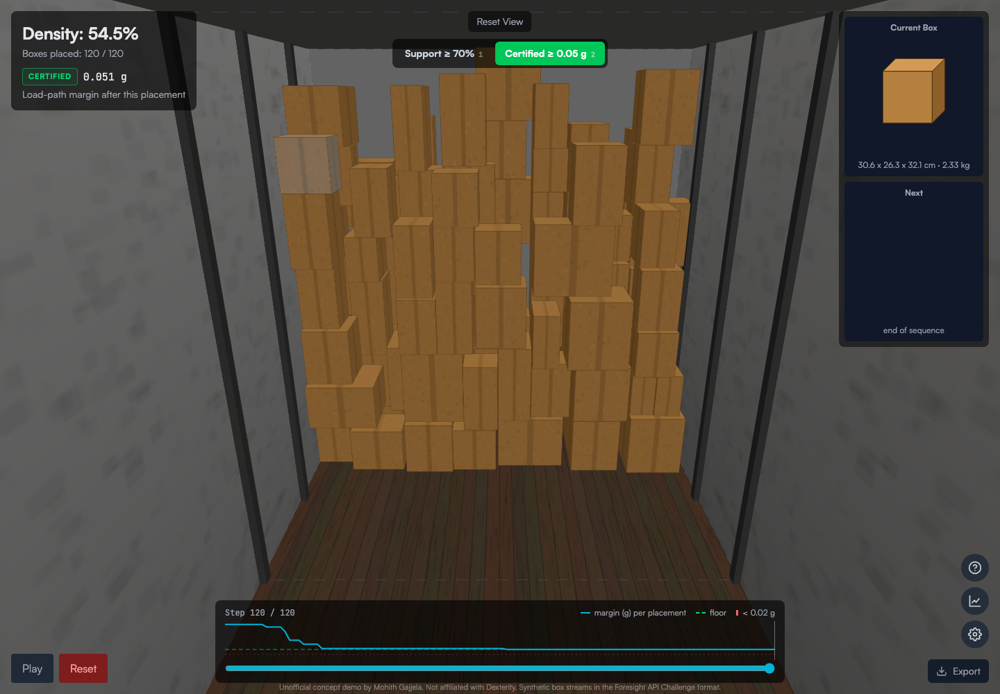

# Load-path certificates for Foresight truck loading (Dexterity concept)

**Live demo:** https://mohith26.github.io/dexterity-load-path-certificates/

A concept feature for Dexterity's Foresight packing agent and the Foresight API Challenge: before a box is committed, prove the wall will stand. For every candidate placement it builds a **load-path certificate**, an explicit set of contact forces that balances every box in the truck, and computes a **stability margin**: the largest door-ward or sideways disturbance (in g) for which such forces still exist. An agent that accepts only certified placements with a margin floor replaces the usual "at least 70% of the base must be supported" rule, which both rejects stable bridges and accepts stacks that cannot balance. The page is a replay viewer built like the dexterity.ai/play truck-loading game: step through all 120 placements, see the margin after each one, click any box to trace its load to the floor, switch between the two acceptance rules, and re-pack any sequence in the browser.



## Results (50 seeded sequences x 120 boxes, challenge truck segment 2.0 x 2.6 x 2.75 m, challenge density formula)

Same greedy wall-builder and candidate order for every row; only the acceptance test changes.

| Acceptance test | IQM density | Worst margin after any placement | Games with a step below 0.02 g |
|---|---:|---:|---:|
| Support ≥ 70% of base (common heuristic) | 45.9% | 0 g (8 games had a placement with no load path at rest) | 23 |
| Support ≥ 80% of base | 35.4% | 0.018 g | 1 |
| Certified, any margin | 55.2% | 0 g | 50 |
| Certified ≥ 0.02 g | 55.3% | 0.020 g | 1 (rounding at the floor) |
| **Certified ≥ 0.05 g** | **51.9%** | **0.050 g** | **0** |
| Certified ≥ 0.08 g | 43.6% | 0.080 g | 0 |

Holding a 0.05 g margin after every placement, the certified agent packs **51.9% IQM density versus 45.9%** for the 70% support rule (+6.0 points), and never drops below its floor, while the support rule let 23 of 50 games dip below 0.02 g and 8 games contain a placement with no load path at all. All numbers are produced by `node scripts/experiment.mjs` into `results/results.json` and the headline is re-checked by the tests.

## How it works

1. **Disturbance as tilted gravity.** A horizontal disturbance a (robot contact, conveyor bump, trailer motion) is modelled by tilting gravity: every body force points along (ax, ay, -1).
2. **Top-down load path.** Boxes are processed from the top. Each box carries its own weight at its centre plus the loads handed to it by boxes above, all parallel, so their resultant is one force through the weighted mean point P. Its line of action meets the box's bottom plane at Q.
3. **Support check.** The box's supports are the overlap rectangles with boxes directly below (or the floor). If Q is inside the convex hull of their corners, Q is written as a convex combination of corners (a mix of the uniform split and the hull edge where the ray from the centroid exits), and those corner forces are handed down. Parallel forces with equal resultant on the same line balance both force and moment exactly.
4. **Certificate.** If every box finds such a split, the force field is an exact static equilibrium of the rigid stack under that disturbance (given friction ≥ |a|, which for cardboard at these margins holds with room to spare). If some box cannot, it is reported as the box where no load path exists.
5. **Margin.** Bisection on a in three directions (toward the open face, left, right) gives the margin. The agent tries candidates in its usual order and takes the first one whose resulting truck is certified at the margin floor in all three directions.

The certificate is sufficient, not necessary: side contacts (neighbours, trailer walls, the previous wall) are ignored, which is conservative, and each load is split in one particular way. Closed-form tests pin it down: a single box tips exactly at a/g = depth/height, an overhang fails, a bridge over two supports with 52% base support passes, and a heavy box on top of an overhanging light box fails even though every box has two-thirds or more of its base supported.

## Tests

`node --test test/loadpath.test.mjs` (13 tests, ~20 s): convex hull; **property test** that the convex-combination split reproduces any inside point with valid weights (400 random cases); single-box tipping matches the closed form; overhang; bridge; heavy-on-overhang stack; **property test** that certified packs conserve load (the floor carries the total weight) and every box's outgoing forces equal its load; packing invariants (inside the truck, no overlaps, every box supported); the certified agent keeps its floor after every placement; deterministic, platform-independent box streams (`src/detmath.js`) with a pinned first box; the challenge density formula and IQM; the **headline** (45.9% vs 51.9% IQM, 23 games below 0.02 g) recomputed from scratch; the page's showcase game. GitHub Actions runs them on every push.

## Data

`L.sequence(seed)` generates 120-box streams in the challenge's API format (dimensions in metres, weight in kg). The challenge's box pool is not public, so sizes and weights are anchored on the public examples in the challenge docs and game (40.6 x 31.0 x 21.1 cm at 3.13 kg; 35.0 x 28.0 x 19.0 cm at 2.45 kg; 41.7 x 38.1 x 34.5 cm): 15-65 cm sides, 60-180 kg/m³. Seeds 1001-1050 are the benchmark set (the size of the challenge's private evaluation).

## Honest limitations

- I can't run the challenge's physics simulator (it needs an API key), so "unstable" here means "no certificate", not "fell over in your simulator". A certificate failure is not proof of collapse (side contacts can hold a box), and a certificate does not model settling, box compliance or impact during placement.
- The comparison uses my greedy agent, not Foresight; absolute densities are lower than the leaderboard's best runs. The point is the delta from changing only the acceptance test.
- Synthetic box pool anchored on three public examples; real parcel mixes (and crush strength, fragile items) would change the numbers.
- Friction is assumed sufficient at the margins tested; a sliding check (|a| ≤ mu) is trivial to add per contact.
- Margins are computed for three horizontal directions; the front direction is backed by the trailer nose / previous wall.

## Prior art and what is new here

Static stability in container loading is well studied: support-area and centre-of-gravity rules are the common heuristics, and Ramos, Oliveira and Lopes (2016) formulated full static mechanical equilibrium for container loading; robotics packing papers use physics rollouts to reject placements. Dexterity's own Foresight post says the packing agent reasons about stability to prevent wall collapses. What I have not seen published for Foresight or the challenge is a certificate-producing check that returns the forces and a margin in g for every placement, is fast enough to sit inside a <400 ms placement loop, and is shown head-to-head against the support-ratio rule on the challenge's own density metric.

## Run it

```
node scripts/experiment.mjs          # 50 sequences x 6 acceptance tests -> results/results.json, data/showcase.json (~90 s)
node --test test/loadpath.test.mjs
python3 -m http.server               # then open http://localhost:8000
```

No build step, no dependencies (three.js from a CDN for the viewer). Keyboard: 1 / 2 switch the acceptance test, arrow keys step, Space plays, C opens the 50-sequence results, R re-packs any seed, E exports the placements as challenge `/place` payloads with their certificates, V resets the view, Esc closes.

Unofficial concept demo by Mohith Gajjela. Not affiliated with Dexterity. Synthetic box streams in the Foresight API Challenge format.
